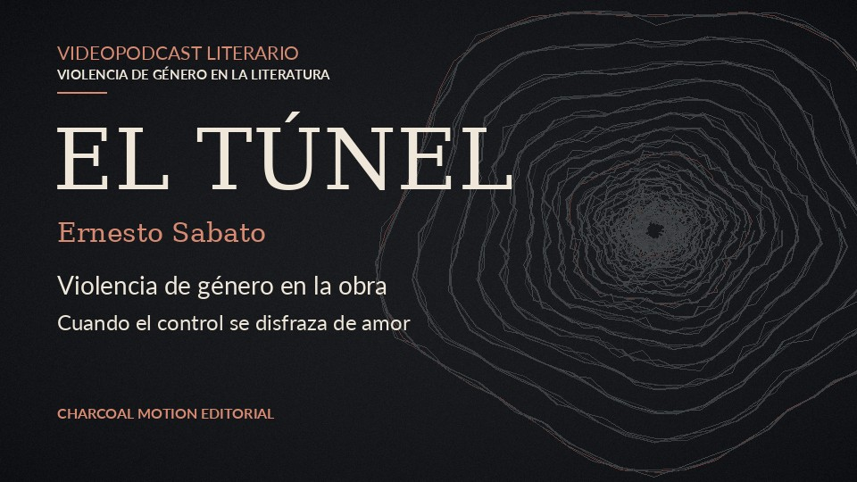

# EL TÚNEL · V03.1

Videopodcast de Literatura del Colegio Humboldt Caracas sobre la violencia de género en la novela de Ernesto Sabato. **Cuando el control se disfraza de amor.** La edición conserva la conversación aprobada e incorpora capítulos, cápsulas de lectura, identificación institucional y un cierre renovado.

La [auditoría audiovisual](docs/V03_AUDITORIA_AUDIOVISUAL.md) y la [EDL](docs/V03_EDL.md) documentan el conformado de 12:10.433. La prueba semestral I se evalúa en cuatro ejes. La [matriz](docs/V03_MATRIZ_RUBRICA.md) vincula los doce criterios con intervenciones y tiempos V03, diferencia cita, paráfrasis e interpretación y registra los límites del cotejo.

| Eje | Indicadores |
|---|---|
| Análisis literario | Manifestaciones de violencia, temas centrales y evidencia de la novela |
| Perspectiva crítica | Postura frente a la violencia, vínculo con la realidad y reflexión del espectador |
| Discurso audiovisual | Estructura, lenguaje y ritmo |
| Producción | Audio, video y uso de los recursos audiovisuales |

## V03.1 · Continuidad y sonido

La revisión sustituye las mezclas de máscara entre entrevistas y cortinas por cortes directos. El título y la mancheta entran con contraste de lectura. Una partitura original de piano y celesta acompaña los capítulos y las cápsulas. En la entrega definitiva, el blooper de coro enlaza directamente con el agradecimiento. El escudo oficial aparece en la apertura y el cierre. La [guía de producción](docs/v03_1/produccion.md) detalla la reproducción y las comprobaciones.

[Escuchar la firma musical de apertura](docs/v03_1/firma-musical.ogg)

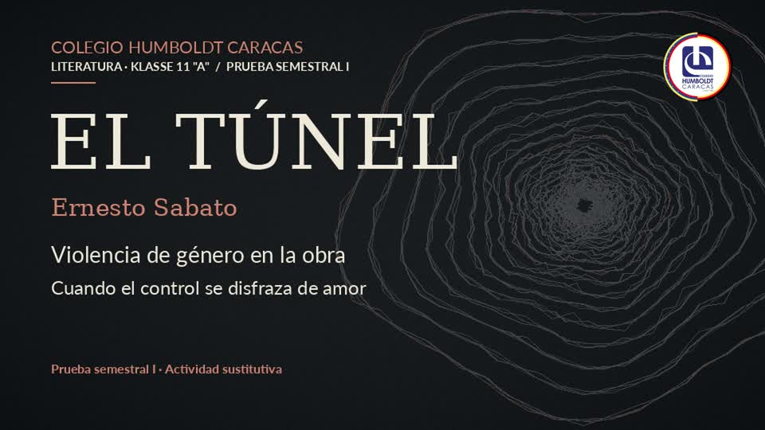

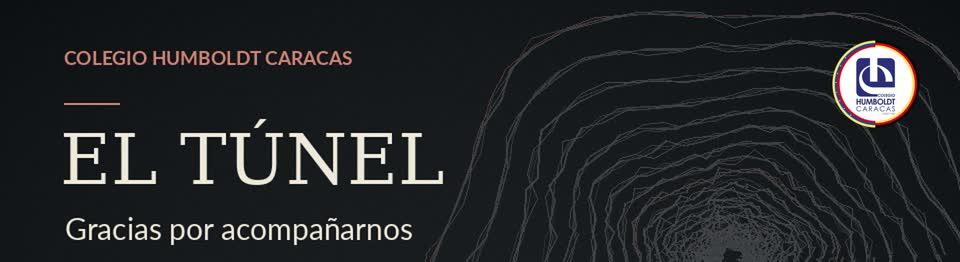

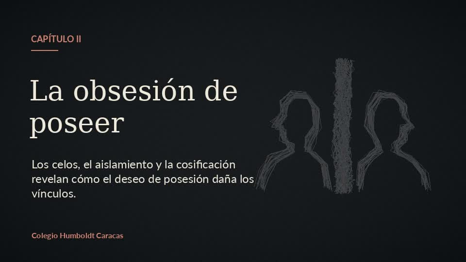

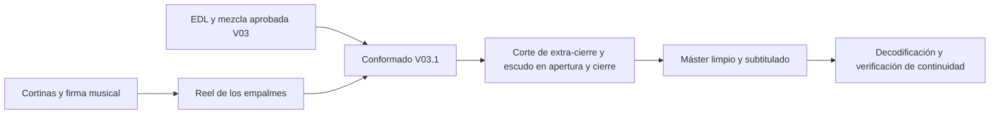

## Galería

La galería muestra arte editorial creado para el proyecto. Las muestras de cierre y bloopers se generaron sin nombres ni retratos.

| | |
|---|---|
| 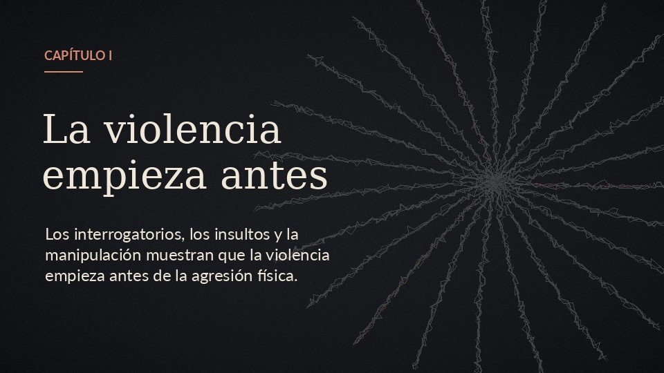 | 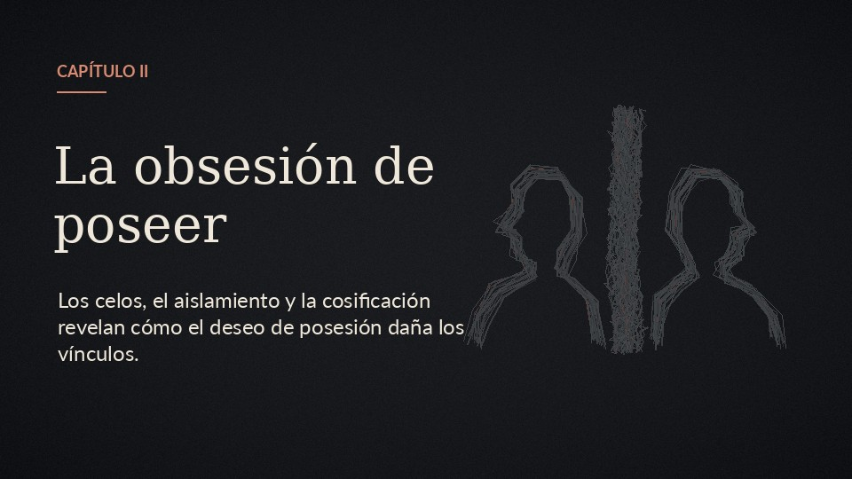 |
| 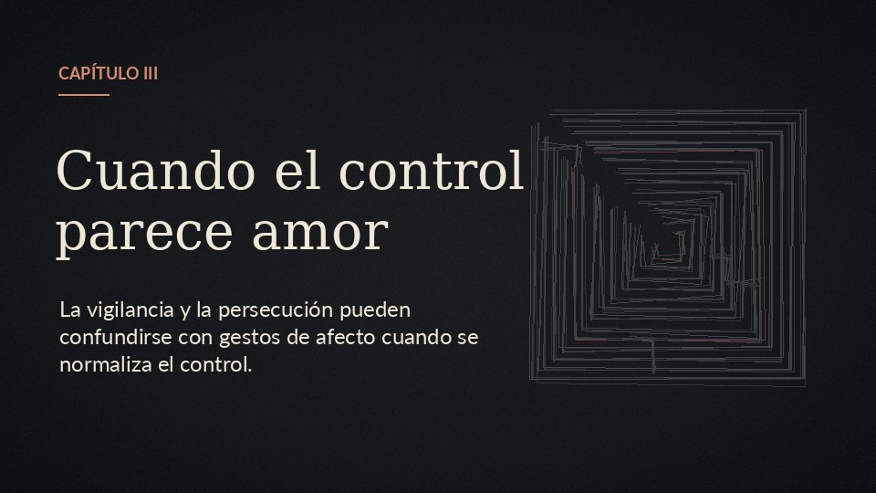 | 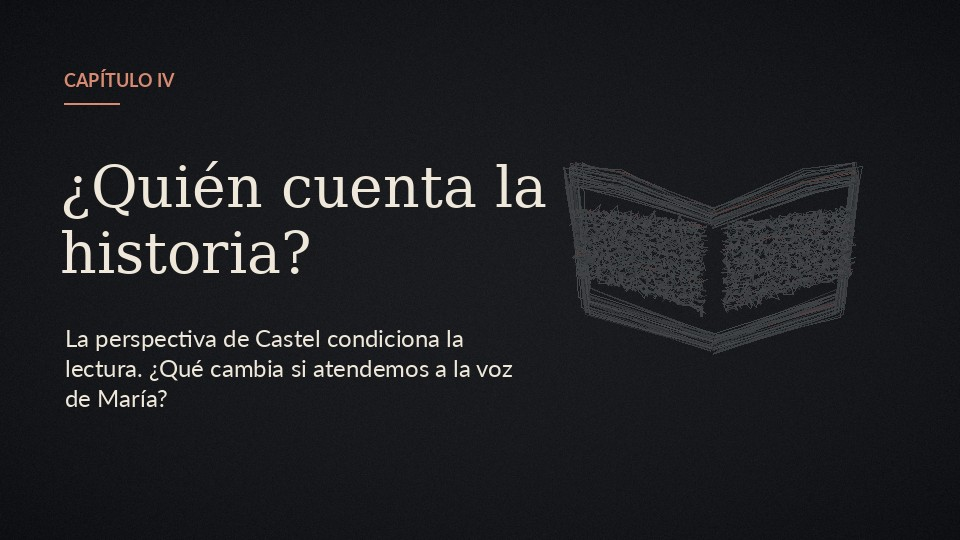 |
| 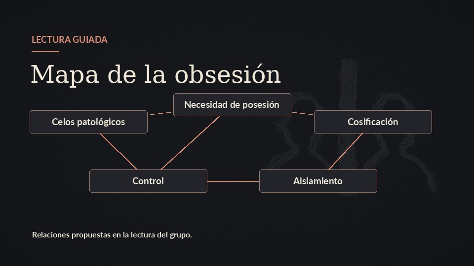 | 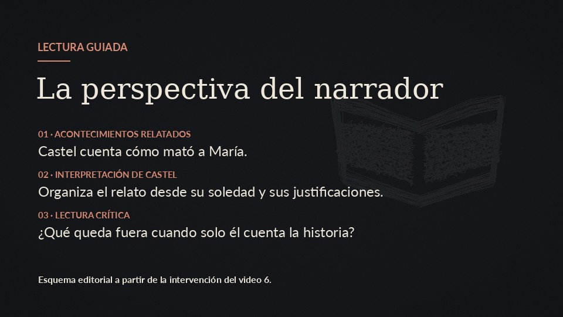 |
| 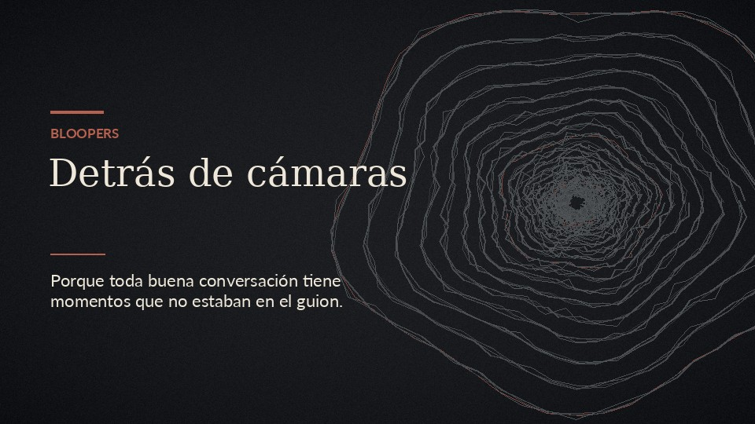 | 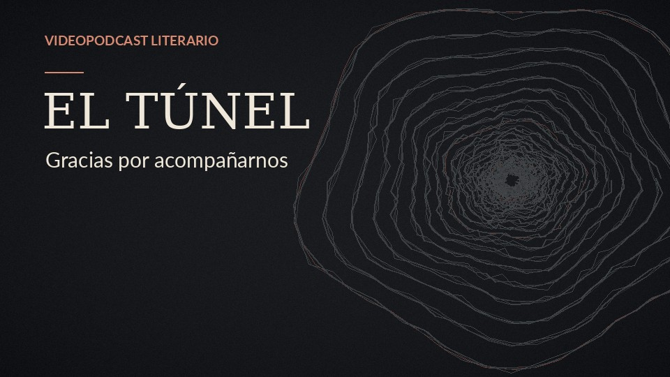 |
| 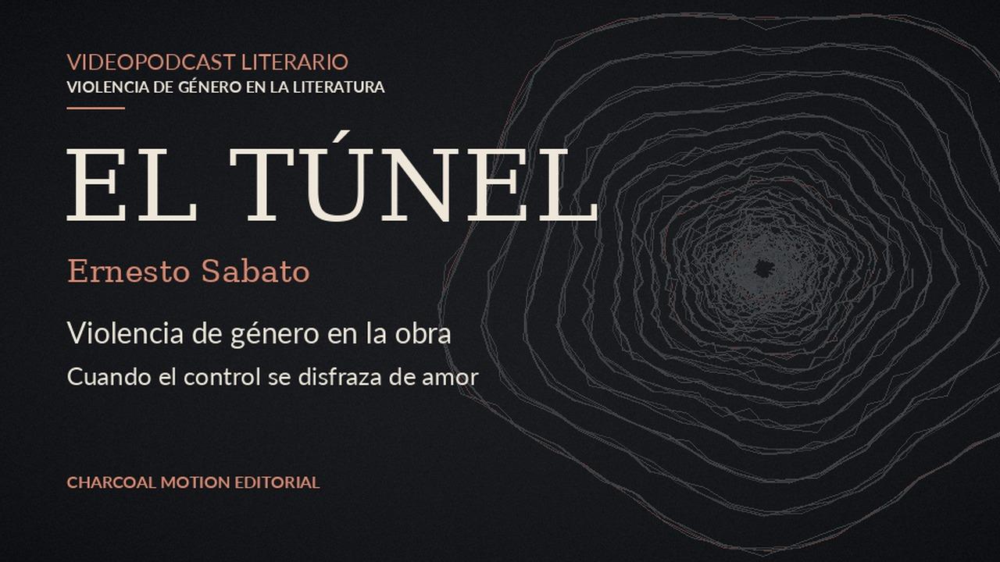 | 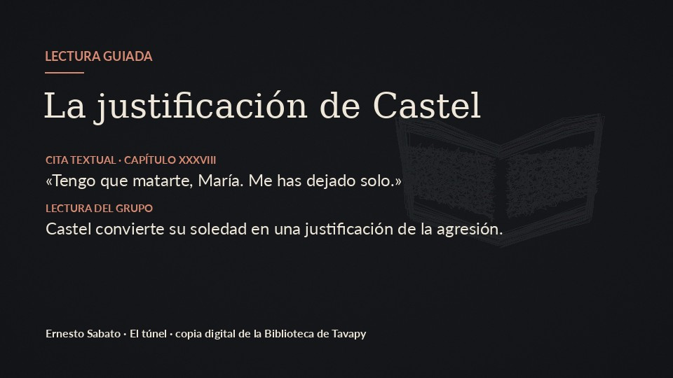 |

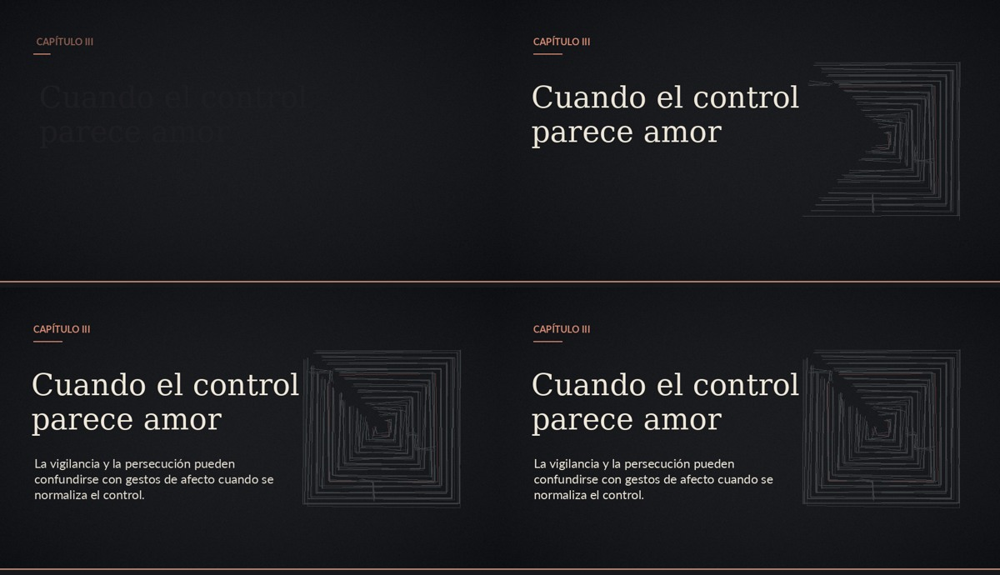

## Arquitectura

**Flujo audiovisual**

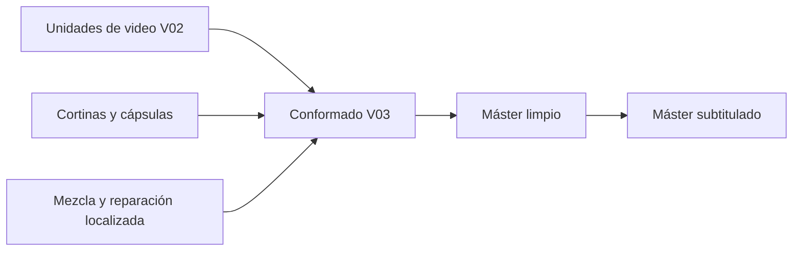

**Renderizado**

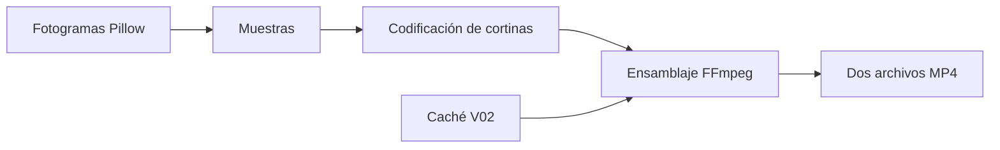

**Control de calidad**

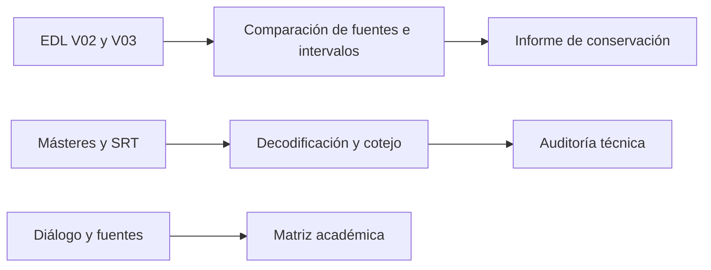

**Configuración y generación**

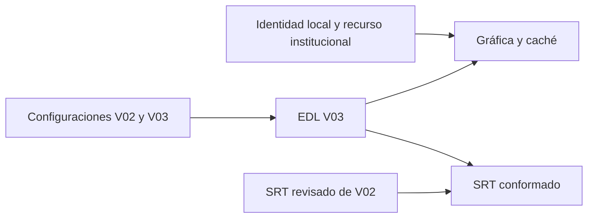

## Reproducción y versiones

La [guía V03](docs/v03.md) detalla dependencias, archivos locales requeridos, configuración, render, subtitulado, auditoría y derechos. El recorrido técnico pasa por `edl`, `preview`, `build` y `audit` en `scripts/v03.py`.

- **V01** · Primer montaje y candidato audiovisual. [Producción](docs/produccion.md).
- **V02** · Recuperación del diálogo grupal y consolidación de la identidad de carboncillo. [Referencia V02](docs/v02.md).
- **V03** · Identidad institucional en texto, revisión pedagógica y cierre editorial.

## Disponibilidad

Los dos másteres definitivos y el SRT están en `renders/v03_1/definitivo/` del entorno de producción. Duración de entrega: 12:03.933. Los archivos aprobados de referencia permanecen en la carpeta superior. La publicación del video y sus materiales identificables queda sujeta a autorización.
