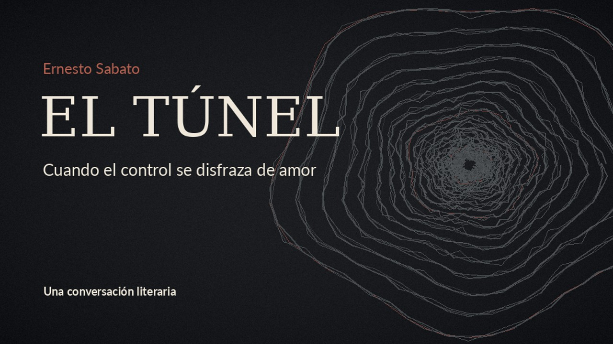
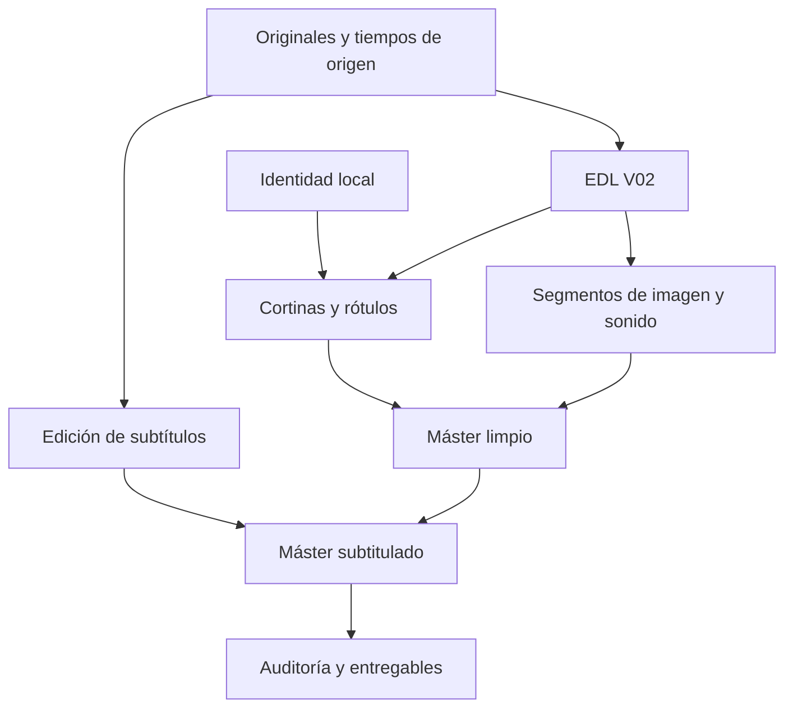
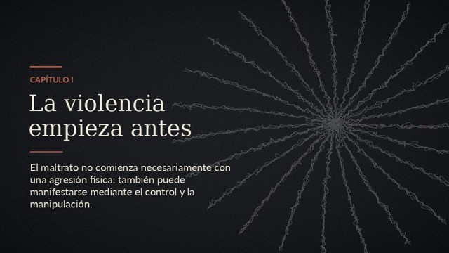
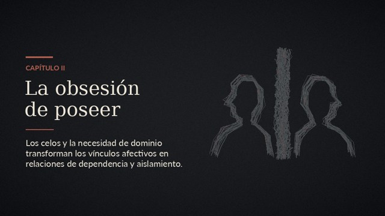
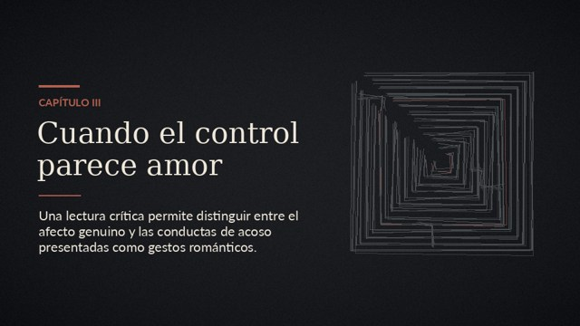
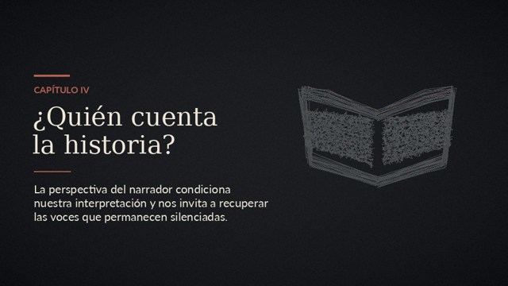

# EL TÚNEL

**Cuando el control se disfraza de amor**  
Podcast grupal de análisis literario sobre la novela de Ernesto Sabato.

`V02` · `Python` · `Pillow` · `FFmpeg` · `1080p / 30 fps`

La V02 recupera el desarrollo de las intervenciones y la despedida del grupo. La puesta en escena **Charcoal Motion Editorial** enlaza la conversación con cuatro cortinas que animan trazo, textura, profundidad y tipografía. Los extras comienzan después del cierre conceptual. La obra termina con un agradecimiento animado.

## Montaje y control de calidad

- [Comparativa V01–V02 y recuperación de diálogos](docs/v02.md)
- [Método de producción y licencias](docs/produccion.md)
- [Configuración editable de montaje](config/v02.json)

Las imágenes publicables del proyecto muestran ilustraciones abstractas generadas por código. Las grabaciones, identificadores personales, subtítulos de origen y másteres se conservan localmente. La publicación audiovisual requiere autorización de los participantes.



## Reproducción local

Requiere Python 3 con Pillow y NumPy, FFmpeg/FFprobe con libass y libx264, fontconfig, DejaVu Serif y Lato. La ingesta opcional puede crear borradores de subtítulos con Faster Whisper local. Para repetir la revisión existente, preservar los SRT de origen con sus identificadores de entrada.

1. Colocar los ocho originales en `podcast_videos_raw/` y los extras en `bloopers/`.
2. Copiar `config/identidad.example.json` a `config/identidad.local.json` y completar allí la identidad autorizada.
3. Colocar los borradores de origen en `work/transcripciones/`.
4. Ejecutar el pipeline en orden.

```sh
python3 scripts/ingest.py
mkdir -p work/v02
sha256sum podcast_videos_raw/*.mp4 bloopers/*.mp4 > work/v02/preservacion.sha256
python3 scripts/v02.py dialogue
python3 scripts/v02.py preview
python3 scripts/v02.py clean
python3 scripts/v02.py subtitled
python3 scripts/v02.py audit
```

| Ruta | Uso |
|---|---|
| `config/v02.json` | Ventanas de origen, cortinas y orden editorial |
| `config/identidad.local.json` | Clase, institución y nombres autorizados, fuera de Git |
| `scripts/v02_motion.py` | Ilustración, máscaras animadas y motivo musical original |
| `work/v02/` | EDL resuelta, evidencias y material interno |
| `renders/v02/` | Dos másteres, miniatura y cortinas individuales |
| `subtitles/` | SRT conformado al montaje |

La V01 se conserva como referencia. El pipeline de la V02 utiliza directorios propios. La salida H.264 en 1080p escala las fuentes de resolución original y conserva sus proporciones. Tipografías del sistema DejaVu Serif y Lato. Música, gráficos y animación generados localmente.

## Galería de cortinas

| I · La violencia empieza antes | II · La obsesión de poseer |
|---|---|
|  |  |
| **III · Cuando el control parece amor** | **IV · ¿Quién cuenta la historia?** |
|  |  |

Los másteres y las capturas de la entrevista permanecen en la entrega local.
